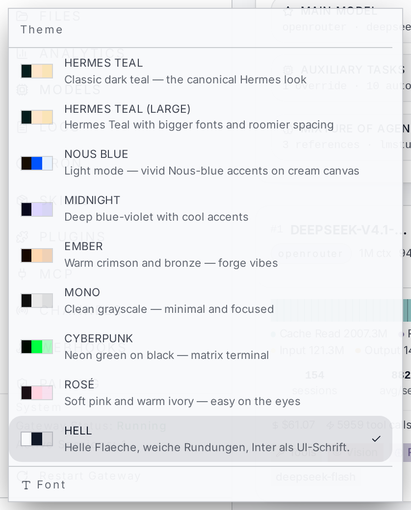
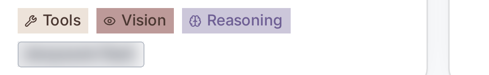

# hermes-dashboard-theming

A light, clean, rounded theme for the **Hermes web dashboard** — plus the skill and the tooling
that an agent needs to build themes like it on its own.

Three things live in this repository:

| What | Where | What it is |
|---|---|---|
| The theme | `themes/light-clean.yaml` | One YAML file. Drop it in, pick it in the dashboard. |
| The skill | `skills/hermes-dashboard-theming/` | Instructions an agent loads to restyle a dashboard: schema, procedures, pitfalls, verification recipes. |
| The color board | `tools/color-board.html` | A single-file page for trying out hex values live: swatch, example badge, derived fills, WCAG contrast, ready-to-paste snippet. |

## The theme



Light canvas, white cards, one modern sans-serif (Inter), rounded corners everywhere, and colour
used only as an accent — buttons, badges and status marks. The noise/grain overlay that makes the
stock themes look retro is switched off.



**Install**

```bash
mkdir -p "$HERMES_HOME/dashboard-themes"          # default: ~/.hermes/dashboard-themes
cp themes/light-clean.yaml "$HERMES_HOME/dashboard-themes/"
hermes config set dashboard.theme light-clean
```

Then reload the dashboard page completely (a plain reload is enough; the theme list is fetched once
per page load). Revert any time with `hermes config set dashboard.theme default`.

Requires a Hermes version whose web dashboard reads user themes from
`$HERMES_HOME/dashboard-themes/` (verified against v2026.9.24).

## The skill

Install it as a **skill tap** — a plain GitHub repository of `SKILL.md` files, no registry, no
server:

```bash
hermes skills tap add atzen1991/hermes-dashboard-theming
```

Or copy the directory into your own skill tree:

```bash
cp -r skills/hermes-dashboard-theming "$HERMES_HOME/skills/devops/"
```

The skill is written for an agent, not for a human reading it top to bottom. It covers:

- the theme schema (palette, typography, layout, `colorOverrides`, `componentStyles`, `customCSS`)
  and which of those fields the shipped build actually reads;
- the three-layer palette and how every derived token cascades from it;
- how to reach the things a theme *cannot* reach — hard-coded Tailwind colours, inline styles,
  the button bezel, the animated button ring, `rounded-none` surfaces;
- measuring instead of guessing: reading computed styles in a real browser, counting rounded
  elements, stacking translucent backgrounds before computing contrast;
- pitfalls that cost hours otherwise, each with the probe that proves it.

Supporting material lives next to it: `references/*.md` (deep dives per topic),
`templates/light-clean-theme.yaml` (a starting point), `scripts/gen_dashboard_themes.py` (builds a
whole family of themes from a palette list).

## The color board

Open `tools/color-board.html` in any browser — no server, no build, no network. Type a hex value or
use the colour picker on the left; the panel on the right updates live with the resulting swatch, an
example badge, the derived surface and border mixes, and the WCAG contrast against the surfaces the
colour actually sits on. The text area at the bottom prints the values and the ready-to-paste theme
snippet.


## Notes

- **Dashboard themes are not CLI skins.** The terminal look is themed by `display.skin` and files in
  `$HERMES_HOME/skins/`; the web dashboard is themed by `dashboard.theme` and files in
  `$HERMES_HOME/dashboard-themes/`. Two systems, two directories.
- The theme is a runtime drop-in: no rebuild, no fork, no patching of the dashboard source. It
  survives application updates because it lives in the persistent Hermes home, not in the app.
- Colour values are plain `#rrggbb`. Contrast targets: text against its real background ≥ 4.5:1,
  large graphics ≥ 3:1, button label against its fill ≥ 3.2:1.

## License

MIT — see [LICENSE](LICENSE).
