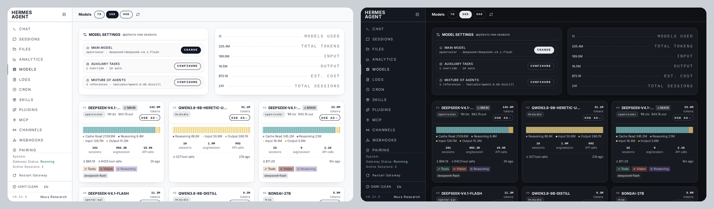
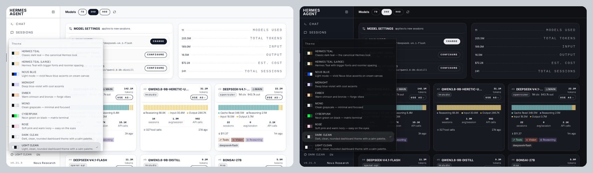
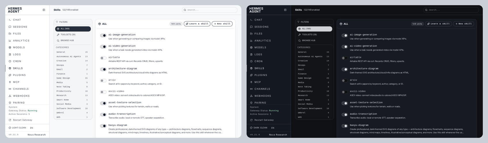
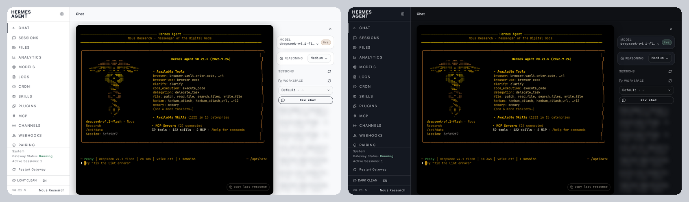
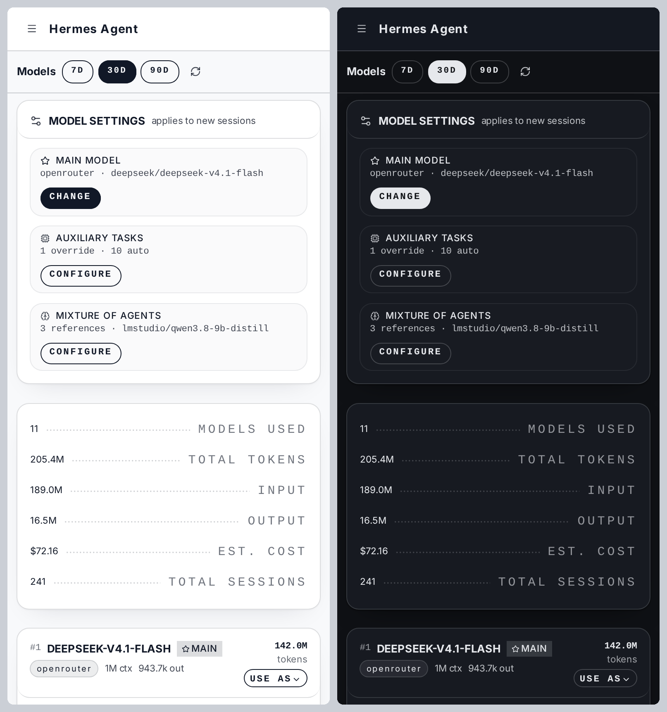
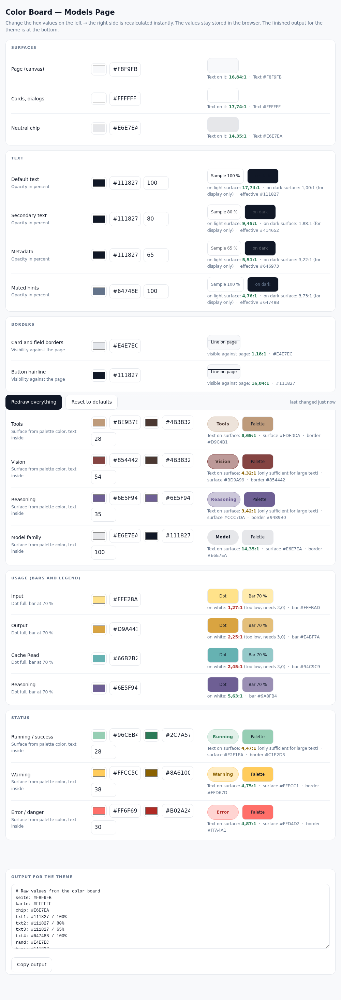
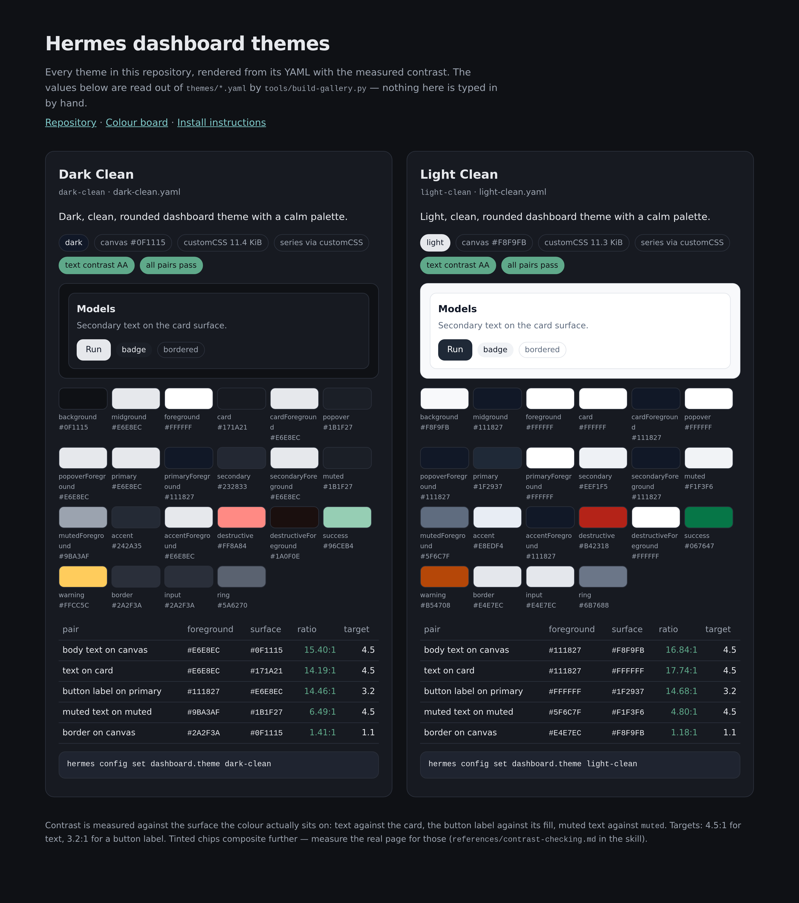
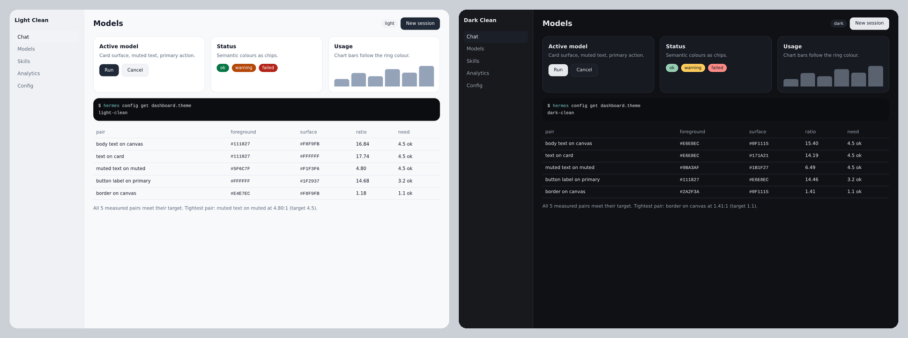

> **Note: this repository was created with the help of AI.**
> The themes, the skill and the tooling were built in a collaboration between a human author
> (direction, design decisions, review) and **Hermes Agent** (implementation, measurements, text).
> Every claim here was checked against a running dashboard, but read the code before you rely on it.

# hermes-dashboard-theming

[](https://github.com/Faultbendfold/hermesagent-dashboard-theming/actions/workflows/validate.yml)
[](LICENSE)

Light and dark, clean, rounded themes for the **Hermes web dashboard** — plus the skill and the
tooling that an agent needs to build themes like them on its own.

What lives here:

| What | Where | What it is |
|---|---|---|
| The themes | `themes/light-clean.yaml`, `themes/dark-clean.yaml` | Two YAML files. Drop them in, pick them in the dashboard. |
| The skill | `skills/hermes-dashboard-theming/` | Instructions an agent loads to restyle a dashboard: schema, procedures, pitfalls, verification recipes. |
| The tools | `tools/`, `skills/hermes-dashboard-theming/scripts/` | Install, scaffold, preview, lint, measure, derive -- see [The command line tools](#the-command-line-tools). |
| The gallery | `docs/index.html` | Every theme with its swatches, a mock of its surfaces and its WCAG summary, generated from the YAML. |
| The schema reference | `docs/schema.md` | Every key the server accepts and what the build actually reads -- generated from the mirror. |
| The tutorial | `docs/anatomy.md` | A theme in ten minutes, from scaffold to installed. |
| The color board | `tools/color-board.html` | A single-file page for trying out hex values live: swatch, example badge, derived fills, WCAG contrast, ready-to-paste snippet. |

Every screenshot below shows the same view twice: **light on the left, dark on the right.**

## The themes



Both themes are one shape with two surfaces. Light: canvas `#F8F9FB`, cards white. Dark: canvas
`#0F1115`, cards `#171A21`. Everything else is shared — one modern sans-serif (Inter) for the whole
UI, rounded corners everywhere, `1rem` radius, the noise/grain overlay switched off, and colour used
only as an accent on buttons, badges and status marks. The roles invert where they must: the light
theme's near-black buttons become light buttons with dark labels in the dark theme.

**Switching is a selection in the dashboard itself:** open the theme control at the bottom of the
sidebar and pick *Light Clean* or *Dark Clean* — every entry shows its description, next to the
stock themes. The theme directory is read once per page load, so anything dropped into
`$HERMES_HOME/dashboard-themes/` appears in that list.







The chat page keeps its terminal dark in both themes — the dashboard paints that panel itself. The
session list on the right is blurred in these screenshots; it shows real session titles.



**Install**

```bash
./install.sh --activate light-clean      # copy both themes, select one
```

or by hand:

```bash
mkdir -p "$HERMES_HOME/dashboard-themes"          # default: ~/.hermes/dashboard-themes
cp themes/light-clean.yaml themes/dark-clean.yaml "$HERMES_HOME/dashboard-themes/"
hermes config set dashboard.theme light-clean      # or: dark-clean
```

Then reload the dashboard page completely (a plain reload is enough; the theme list is fetched once
per page load) — or simply pick the theme in the UI as described above. Revert any time with
`hermes config set dashboard.theme default`.

Requires a Hermes version whose web dashboard reads user themes from
`$HERMES_HOME/dashboard-themes/` (verified against v2026.9.24).

## The skill

Install it as a **skill tap** — a plain GitHub repository of `SKILL.md` files, no registry, no
server:

```bash
hermes skills tap add Faultbendfold/hermesagent-dashboard-theming
```

Or copy the directory into your own skill tree:

```bash
cp -r skills/hermes-dashboard-theming "$HERMES_HOME/skills/devops/"
```

A tap only registers a source; the skill files arrive when you install from it. If you already have
a skill with this `name:` in your tree, installing this one shadows it -- Hermes warns about it, and
to keep both, rename the older one or install this into a category directory.

The skill is written for an agent, not for a human reading it top to bottom. It covers:

- the theme schema (palette, typography, layout, `colorOverrides`, `componentStyles`, `customCSS`)
  and which of those fields the shipped build actually reads;
- the three-layer palette and how every derived token cascades from it;
- the light recipe, and how to derive the **dark counterpart** from it — which roles invert, which
  surfaces stay, which tones have to be lifted;
- how to reach the things a theme *cannot* reach — hard-coded Tailwind colours, inline styles,
  the button bezel, the animated button ring, `rounded-none` surfaces;
- measuring instead of guessing: reading computed styles in a real browser, counting rounded
  elements, stacking translucent backgrounds before computing contrast;
- pitfalls that cost hours otherwise, each with the probe that proves it.

Supporting material lives next to it: `references/*.md` (deep dives per topic, including
`contrast-checking.md` with its three classic false alarms), `templates/light-clean-theme.yaml`
(a starting point), `scripts/gen_dashboard_themes.py` (builds a whole family of themes from a palette
list) — all of those paths are inside `skills/hermes-dashboard-theming/`.

## The color board

Open `tools/color-board.html` in any browser — no server, no build, no network. Type a hex value or
use the colour picker on the left; the panel on the right updates live with the resulting swatch, an
example badge, the derived surface and border mixes, and the WCAG contrast against the surfaces the
colour actually sits on. The text area at the bottom prints the values and the ready-to-paste theme
snippet.



## The command line tools

The scripts that do the parts you would otherwise do by hand — or forget to do. All of them are
plain `python3` and `sh`: no pip install, no PyYAML, no network. The ones an agent needs mid-task
live next to the skill, so a tap install delivers them too; the rest sit in `tools/`.

**`install.sh`** — copies `themes/*.yaml` into `$HERMES_HOME/dashboard-themes/`, optionally selects
one, and never overwrites a file that differs without `--force` (which keeps a timestamped `.bak`).

```bash
./install.sh --list                      # what is in this repository
./install.sh --activate dark-clean
./install.sh --dest /opt/data/dashboard-themes
```

**`skills/hermes-dashboard-theming/scripts/theme-check.py`** — lints a theme before you trust it.
A theme fails silently: the server discards keys it does not know, the build ignores buckets nobody
reads, and a colour that is too pale simply looks wrong. The checker parses the YAML with its own
tiny reader and reports each of those, plus the contrast of every text/surface pair. Exit code 1
when it finds something, so it can gate a CI job.

```console
$ python3 skills/hermes-dashboard-theming/scripts/theme-check.py themes/light-clean.yaml
themes/light-clean.yaml
  name 'light-clean'   mode light   canvas #F8F9FB   customCSS 11.2 KiB
  WARNS (2)
    [dropped-seriesColors] `seriesColors` is accepted but dropped before it reaches the
      surface: use customCSS with --series-input-token/--series-output-token and !important
    [contrast] muted text: 4.28:1 (#64748B on #F1F3F6), below 4.5:1 -- mutedForeground on muted
  0 error(s), 2 warning(s), 5 note(s)
```

Add `--live --hermes /path/to/hermes` to check the file against the Hermes that is actually
installed: it imports that version's own normaliser, runs the theme through it and reports any drift
against the schema the tool mirrors.

**`skills/hermes-dashboard-theming/scripts/make-dark-twin.py`** — derives the dark counterpart of a
light theme by the documented rules (canvas from the ink hue, ink lifted to ≥ 7:1, surfaces stepped
off the canvas, a dark `primary` inverted, semantic tones lifted), prints the measured contrast
table, and lists the hardcoded colours in the carried-over `customCSS` that still need a human
decision. Its output is a starting point, not a finished theme.

```bash
python3 skills/hermes-dashboard-theming/scripts/make-dark-twin.py themes/light-clean.yaml
```

**`tools/new-theme.py`** — writes a commented skeleton that already passes the linter, every
supported key included and the colours derived so the contrast targets hold from the start.

```bash
python3 tools/new-theme.py aurora --accent "#7C5CFF"          # light half
python3 tools/new-theme.py aurora-night --accent "#7C5CFF" --mode dark
```

**`tools/preview.py`** — renders a theme as a standalone HTML page: sidebar, cards, buttons, chips,
chart bars, painted from your tokens. No install, no server, no Hermes.

```bash
python3 tools/preview.py themes/light-clean.yaml --open
```

**`tools/contrast-report.py`** — the full contrast matrix of a theme (not just the failures), as
text, Markdown or JSON. JSON and Markdown are what a pull request wants to show.

```bash
python3 tools/contrast-report.py --format markdown themes/*.yaml
```

**`tools/gen-schema-doc.py`** — writes `docs/schema.md` from the schema mirror, so the reference and
the linter cannot drift apart.

**`tools/verify.sh`** — every check in one command: syntax, `theme-check --strict`, the generated
files, and the tests. This is what CI runs.

```console
$ ./tools/verify.sh
=== theme-check (warnings treated as errors)
  ok   themes/*.yaml
=== docs/ matches the generators
  ok   docs/index.html, docs/schema.md
=== unit and integration tests
  ok   tests/
verify: all checks passed
```

The shared code — the YAML-subset reader, the colour maths and the schema mirror — lives in
`skills/hermes-dashboard-theming/scripts/theme_lib.py`; import it rather than re-deriving
`lum`/`ratio`/`mix`. (Careful: the `scripts/` at the repository root is a different thing — it holds
`pair_screenshots.py`, the screenshot compositor.)

## Browse it without installing

`docs/index.html` is generated from `themes/*.yaml` by `tools/build-gallery.py`: every theme with its
palette, a mock of its surfaces, its full contrast table and a WCAG summary chip. Each card links to
a **full-size preview page** (`docs/preview-<name>.html`) written by the same renderer as
`tools/preview.py` -- a whole mock dashboard painted from that theme's tokens, with the measured
contrast summary underneath.

Open it from the file system, or from GitHub Pages (repository **Settings → Pages → Deploy from a
branch → `main` / `docs`**), which serves the gallery, the colour board and every preview page.



The preview page itself, light on the left and dark on the right:



## Tests

`tests/` holds `unittest` suites: the contrast maths and the YAML-subset reader (including the
regression that `fit()` used to walk the wrong way), plus black-box tests that run the tools as
subprocesses and assert the exit codes and findings a CI job sees.

```bash
python3 -m unittest discover -s tests -v
```

`tests/test_scripts.py` also fails when `docs/` or `docs/schema.md` is out of date, so a forgotten
regeneration cannot be merged.

## Notes

- **Dashboard themes are not CLI skins.** The terminal look is themed by `display.skin` and files in
  `$HERMES_HOME/skins/`; the web dashboard is themed by `dashboard.theme` and files in
  `$HERMES_HOME/dashboard-themes/`. Two systems, two directories.
- A theme is a runtime drop-in: no rebuild, no fork, no patching of the dashboard source. It
  survives application updates because it lives in the persistent Hermes home, not in the app.
- Colour values are plain `#rrggbb`. Contrast targets: text against its real background ≥ 4.5:1,
  large graphics ≥ 3:1, button label against its fill ≥ 3.2:1.
- The screenshots are composited from two captures of the same page — same viewport, same state,
  only the theme changed. `scripts/pair_screenshots.py` does that composition.
- The tools carry a mirror of the schema the server accepts (`theme_lib.py`). When a Hermes update
  changes it, `theme-check.py --live` reports the drift against the installed version instead of
  leaving you to find out on the page.

## Contributing

See [CONTRIBUTING.md](CONTRIBUTING.md). Themes, fixes and new pitfalls are welcome; the one rule is
that every claim about the dashboard comes with the probe that proves it.

## License

MIT — see [LICENSE](LICENSE). Change history: [CHANGELOG.md](CHANGELOG.md).
